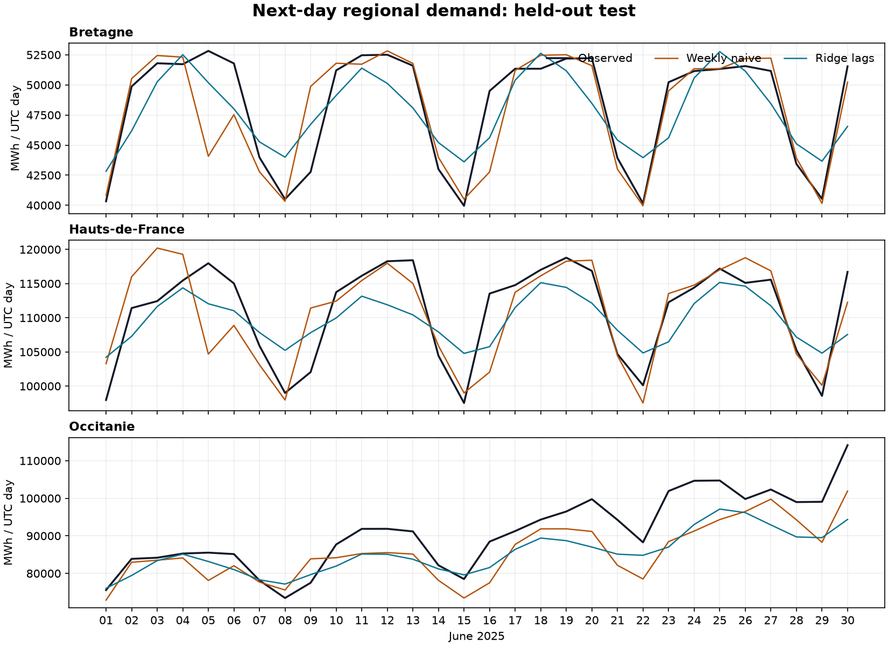

# EnerFlow — Regional electricity demand forecasting

**Mustapha HARRACHI · ECE Paris · Data & AI engineering portfolio**

Can a small, auditable model improve **next-day regional electricity demand** forecasts over repeating the demand from the same weekday one week earlier? EnerFlow turns public RTE half-hourly observations into validated daily energy indicators, then compares a weekly reference with a causal Ridge model. In the held-out June 2025 period, the Ridge model **did not beat the reference**. This negative result is part of the project, not hidden by model selection on the test set.

**Résumé français.** EnerFlow transforme les données régionales publiques de RTE en séries quotidiennes contrôlées et évalue une prévision de consommation à J+1. Sur juin 2025, la référence hebdomadaire reste meilleure que le modèle Ridge. Le rapport présente les erreurs, les limites et la procédure de reproduction.

## Business use and measured result

An energy operations analyst could use a day-ahead estimate to plan review of regional demand. The target is **daily consumption in MWh per UTC day**. The forecast is made with consumption observed through the previous UTC day; the backtest assumes those observations are available on time. The model is a decision aid, not a live operational service.

| June 2025 holdout, 90 region-days | Weekly naive | Ridge with lags |
|---|---:|---:|
| MAE (MWh per region-day) | **3,509.13** | 4,298.49 |
| RMSE (MWh) | **5,144.47** | 5,464.35 |
| WAPE | **4.21%** | 5.15% |

The Ridge model improved over the reference on **May validation** (MAE 3,365.66 vs 3,978.47 MWh), but generalized poorly to June. Its June MAE was higher in all three regions, most notably Bretagne. Full-precision results and all 90 predictions are in [metrics.json](reports/metrics.json) and [test_predictions.csv](reports/test_predictions.csv). The visual error review is in the [local HTML report](reports/index.html), with a [forecast chart](reports/test_forecasts.png).



## Data, provenance, and redistribution

Source: **RTE**, [ODRÉ éCO2mix regional consolidated and definitive dataset](https://odre.opendatasoft.com/explore/dataset/eco2mix-regional-cons-def/), published under **Licence Ouverte 2.0 (Etalab)**. The source combines consolidated and definitive observations; this project does not claim each 2025 record is definitive. The downloaded local snapshot covers **2025-01-01 to 2025-06-30**, Bretagne, Hauts-de-France, and Occitanie. It has **26,070 rows**, **11 columns**, and **2,138,478 bytes**. Original local file SHA-256: `631b87cc0c89a6724ba4b523306bbfdcbe32725b06905167415589ef16237109`.

The raw file is excluded from Git. The downloader uses the official public API and validates size and schema. A fresh API download on 2026-11-22 had the **same rows as a multiset** but a different byte hash because export order changed. Thus the hash identifies the original local snapshot, not a required hash for future downloads. Retain RTE attribution and the source license when reusing the data. No private pharmaceutical file, credential, or model artifact is included.

The raw fields are region code/name, local date/time, UTC timestamp, consumption, wind, solar, hydro, bioenergy, and physical exchanges. Measurements are MW at 30-minute intervals. Six source records for the nonexistent local 02:00/02:30 hour on the March 2025 daylight-saving transition are rejected; the cleaned table contains **26,064 rows**. Each of the **543 region-days** has 48 valid intervals. Daily MWh is estimated as `sum(MW × 0.5 hours)`. The renewable-production-to-consumption ratio is an accounting indicator, not a measure of locally consumed renewable electricity.

## Architecture

```text
RTE ODRÉ API → Bronze CSV (local, ignored by Git)
             → Silver typed/rejected Parquet + quality JSON
             → Gold UTC daily/regional Parquet
             → Causal lag features → weekly reference + Ridge
             → test metrics, predictions, PNG, HTML report
```

`src/01_extract_rte.py` downloads the source; `02_build_silver.py` validates and types it; `03_build_gold.py` creates daily and regional aggregates; `04_validate_independent.py` recalculates regional totals from the raw CSV with Python `Decimal`; `05_benchmark_formats.py` is an optional storage benchmark from the earlier pipeline; `forecasting.py` contains the reusable forecast logic; `06_forecast.py` evaluates and renders the report. Split dates and Ridge regularization candidates are declared in [config/experiment.json](config/experiment.json). See [technical notes](docs/TECHNICAL.md) for feature timing, error analysis, and limitations. Existing `evidence/` images are execution captures from the earlier data pipeline; current forecast visuals are generated by `06_forecast.py`.

## Reproduce

Python **3.12** is used in CI and for the measured run. The full direct/transitive dependency versions are pinned in `requirements.txt`.

```bash
git clone https://github.com/Mustapha-HARRACHI/enerflow.git
cd enerflow
python3.12 -m venv .venv
.venv/bin/python -m pip install -r requirements.txt
.venv/bin/python src/01_extract_rte.py
.venv/bin/python src/02_build_silver.py
.venv/bin/python src/03_build_gold.py
.venv/bin/python src/04_validate_independent.py
.venv/bin/python -m pytest -q
.venv/bin/python src/06_forecast.py evaluate
.venv/bin/python src/06_forecast.py predict --region Bretagne --date 2025-06-15
```

If you already have the **verified** original snapshot at `data/raw/rte_energy.csv`, skip the download. Open `reports/index.html` locally for a demonstrable report; `predict` prints an actual held-out example from the generated predictions. No API server or deployment is claimed. The optional DuckDB CSV/Parquet benchmark is `python src/05_benchmark_formats.py`; its timings depend on hardware and are not used as model metrics.

The local verification on 2026-11-22 passed Silver/Gold transformations, independent aggregate validation, **3 pytest tests**, forecast generation, and the example prediction. GitHub Actions repeats extraction, transformations, checks, and evaluation on pushes and pull requests. The remote CI status should be checked after publication.

## Limits and next steps

- Only six months and three regions: no winter-to-winter or multi-year generalization claim.
- Retrospective one-step forecasts use the previous day's **actual** demand; delayed measurements would change operational performance.
- No weather, holiday, or external calendar feeds; their availability and forecast lead time must be validated before use.
- Model selection used May only; June was held out. The June underperformance suggests distribution shift or underfitting, but this sample alone does not establish the cause.
- Next: acquire a longer licensed history, add walk-forward evaluation across seasons, and only then test weather forecasts or per-region models.

## Three verifiable CV lines

- Built an RTE regional electricity pipeline from 26,070 half-hourly records, with typed Silver/Gold Parquet outputs and an independent aggregate validation.
- Designed a leakage-aware next-day demand backtest with chronological train/validation/test partitions, a weekly baseline, and a Ridge lag model.
- Published an honest June 2025 evaluation and browsable error report; the weekly baseline achieved 3,509 MWh MAE versus 4,298 MWh for Ridge across 90 region-days.
